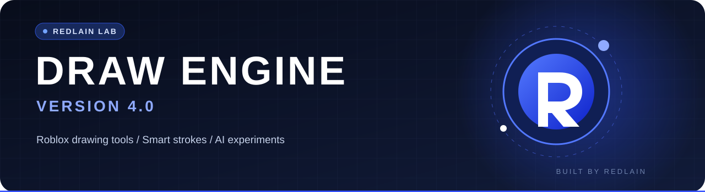

 

**Draw ideas. Automate strokes. Experiment with AI.**

A desktop drawing toolkit built by REDLAIN for creative workflows and Roblox drawing experiences.

**[🚀 Quick start](#-quick-start)** · **[✨ Features](#-features)** · **[📚 Documentation](#-documentation)** · **[💬 Devlog](https://t.me/redlain_devlog)**

---

## ✦ About

**REDLAIN Draw Engine 3.0** (formerly Anime Drawer) turns images into planned drawing strokes and can execute them through ordinary Windows input. The project brings together computer vision, vector-style planning, editable drawing profiles and experimental AI image generation.

Built as a personal project, developed iteratively, and shared openly.

> **Important:** A working local test canvas does not guarantee compatibility with every Roblox drawing place. Calibrate the target UI and run **TEST DRAW** first. Live Roblox validation and a distributable Windows build remain separate steps.

## ✨ Features

| | Capability | What it does |
|:--:|---|---|
| 🎨 | **Human 3.0** | Multi-stage drawing plans, project checkpoints and resume |
| 🧠 | **Smart planning** | Image segmentation, prioritized contours and stroke paths |
| 🖼️ | **Image workspace** | Import images, preview processed strokes and test locally |
| 🎯 | **Custom profiles** | Calibrate palettes, canvas geometry and brush sizes |
| ⚡ | **Speed controls** | Adjustable speeds, calibration and practical time estimates |
| ⏯️ | **Pause & Save** | Save progress and resume supported incomplete projects |
| 🤖 | **Optional AI** | Connect a compatible remote image generation API |

## 🚀 Quick start

**Requirements:** Windows 10/11 x64 and Python **3.11–3.13** (with Python Launcher or Python on PATH).

1. Download the repository via **Code → Download ZIP**, then extract the **entire folder**.
2. Double-click **`run.bat`**. The first launch installs dependencies.
3. Open **TOOLS → LOCAL CANVAS** and verify a test drawing.
4. Import an image, inspect **PREVIEW**, then use **RUN**.
5. For Roblox, create or select a matching game profile and perform **TEST DRAW** before drawing.

**F8** — pause/resume · **F9** — emergency stop.

> The repository ZIP contains **source code**, not a ready-made EXE. For a Windows build, use `build.bat` and keep the generated `RedlainDrawEngine` folder intact.

## 📚 Documentation

| Guide | Description |
|---|---|
| [Start here — RU](START_HERE_RU.md) | Fast setup and first launch |
| [3.0 guide — RU](V3_GUIDE_RU.md) | Main interface, Human 3.0 and workflows |
| [Roblox setup — RU](ROBLOX_START_RU.md) | Game profiles and calibration |
| [New Roblox place — RU](NEW_PLACE_RU.md) | Configure a new RGB-based drawing place |
| [Pause and resume — RU](AUTO_PAUSE_RU.md) | Recover and continue a drawing |
| [Windows/Roblox checks — RU](docs/WINDOWS_ROBLOX_TEST_RU.md) | Acceptance checks and limitations |
| [Full technical manual — RU](FULL_MANUAL_RU.md) | Original detailed documentation, preserved intact |

## 🔧 Built with

**Python · PySide6 · NumPy · OpenCV · Windows input automation**

Source structure: `app/` (application), `tests/` (automated tests), `tools/` (developer tools), `assets/` (visual assets).

## 💬 Follow the devlog

I'm **REDLAIN** — experimenting with Roblox development, AI tools, creative coding, and ideas that sometimes work unexpectedly well.

Find development notes, updates, free tools and real behind-the-scenes stories in **[REDLAIN / DEVLOG on Telegram](https://t.me/redlain_devlog)**.

**Made with curiosity by [@REDLAIN228](https://github.com/REDLAIN228)**

*Building · Breaking · Learning*

