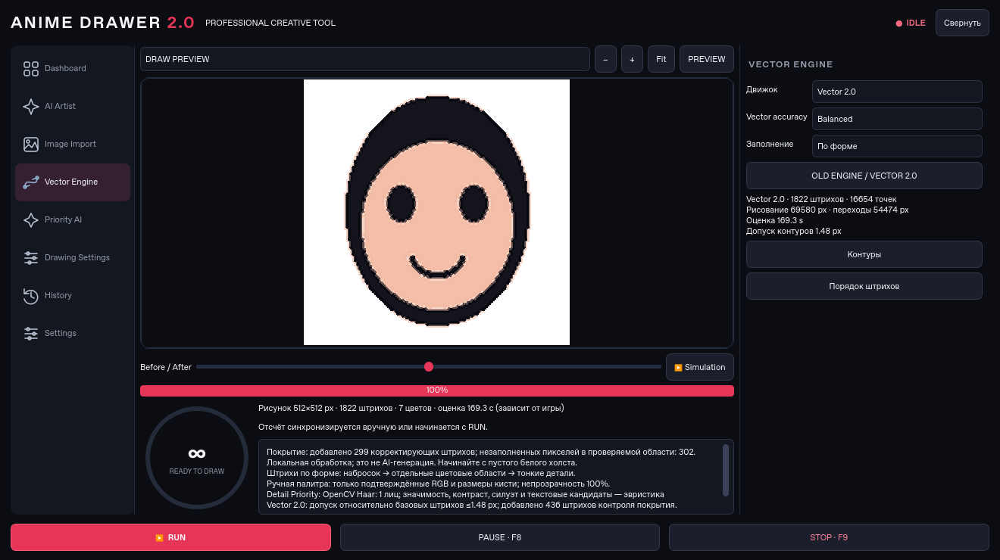

# ANIME DRAWER 2.0 — проверка и измерения

Измерения выполнены 18 октября 2026 года в облачной Linux-среде, Python 3.12, OpenCV 4.11, PySide6 6.8.3, CPU. Команда: `QT_QPA_PLATFORM=offscreen .venv/bin/python tools/benchmark_v2.py`. Генератор создаёт воспроизводимые PNG с портретом, пейзажем и текстурой/надписью в `artifacts/v2-benchmark`.

**Итог первой регрессии 2.0: 106 passed.** Проверка запуска Qt-интерфейса прошла; компоновка дополнительно проверена на 1320×740 и 850×700.

После исправлений управления кистью, хвостов и TEST DRAW: **122 passed**. Добавлены проверки пропущенных стрелок, позднего обновления размера, задержанного отпускания кнопки, сохранения тонкого угла на модели цели 60 Гц, повторного выбора цвета после сбоя и остановки при неподтверждённом цвете. TEST DRAW сохраняет реальные снимки области холста, отличает пустой результат от слишком толстой линии/соединительного хвоста; счётчик берёт число штрихов текущего теста. Проверен запуск Qt-интерфейса без ошибок. Эти проверки включают локальную Qt-доставку событий, но **не являются проверкой исправлений в Roblox/Win32**. Таблицы ниже относятся к первоначальной сравнительной серии 2.0 на обычной локальной палитре; новые интервалы игрового профиля в них не измерялись.

Это снимок работающей программы с синтетическим тестовым портретом, не дизайн-макет. Нативные рамки и шрифты Windows могут отличаться.

[Три исходных PNG для проверки](../assets/v2-examples) включены в ZIP.

## Что проверено

- Импорт, стили, Full HD, форматы и физическое расположение рисунка.
- Карты приоритетов, ручное повышение/понижение, преобразование областей при вписывании/обрезке, загрузка локальных Haar/HOG-моделей.
- RDP/Bezier, сохранение острых углов и глаз, отсутствие соединений через белую щель, сохранение перекрывающихся разноцветных слоёв, допустимые кисти и проверка покрытия.
- Бюджет с защищёнными контурами, целостность заливки связной области, отказ при невозможном лимите и Smart Finish до начала слишком дорогого штриха/заливки.
- Монотонное время, пауза без продления раунда, STOP/release, отдельные измерения для профилей/скоростей.
- Полный интерфейсный сценарий: тестовая калибровка → импорт → V2 PREVIEW → кэш → реальное сравнение Legacy/V2 → симуляция → доставка Qt-событий на локальный холст.
- Ручная область после zoom, раскрытие виджета и Pause/Stop, сохранение пресета, старые JSON-планы без полей 2.0.

## Реальные планы без ограничения времени

Все изображения и физический размер в этой сравнительной серии — 128×128. Палитра и кисти одинаковы: локальный холст поддерживает 3/9/18 px. Детекторы лиц выключены для контролируемого сравнения. Столбец оценки относится к Normal и обычной тестовой палитре; стоимость HSV/OCR Roblox в эти числа не включена. Реальное локальное исполнение намеренно использует ускоренные параметры `event=.0001`, `settle=.0001`, `pixels_per_second=1e6`, `sample_pixels=40`; они применяются только к нашему Qt-окну. Эти секунды **не являются временем рисования в Roblox**.

| Изображение | Движок | Штрихи | Точки | Путь рисования, px | Переходы, px | Расчёт, s | Оценка Normal, s | Реальное Qt-исполнение, s | Совпадение Qt с источником |
|---|---|---:|---:|---:|---:|---:|---:|---:|---:|
| portrait | Legacy | 80 | 1792 | 4778 | 1972 | 0.028 | 40.94 | 5.13 | 94.4% |
| portrait | Vector 2.0 | 132 | 2311 | 5360 | 1721 | 0.098 | 50.24 | 6.50 | 95.1% |
| landscape | Legacy | 113 | 1372 | 6564 | 4986 | 0.019 | 48.70 | 4.48 | 94.3% |
| landscape | Vector 2.0 | 141 | 1602 | 8231 | 4298 | 0.075 | 59.23 | 5.29 | 94.8% |
| texture_text | Legacy | 55 | 1789 | 4212 | 2900 | 0.018 | 36.29 | 5.13 | 79.3% |
| texture_text | Vector 2.0 | 73 | 2132 | 4346 | 2261 | 0.117 | 42.10 | 6.12 | 77.9% |

У каждого из шести исполнений исход: `finished`, ошибок нет, окно получило настоящие Qt mouse events и изменило пиксели. Это сильнее растрового preview, но **не проверяет Win32 SendInput или Roblox**.

В безлимитном режиме V2 сократил длину переходов на этих примерах, но увеличил число штрихов и время. Новая версия не заявляется универсально быстрее. В частности, минимум 3 px ухудшает маленький текст; на texture_text сохранность важных пикселей V2 оказалась ниже Legacy. Тонкая откалиброванная кисть и более крупный рисунок нужны для таких деталей.

## Адаптация к тому же бюджету

Здесь доступное полезное время равно исходной оценке Legacy; отдельно добавлен Safety Buffer 8 s. Это реальные сокращённые V2-планы, проверенные растрово, **не отдельные запуски ввода**. Защищённые контуры сохранялись, заливки выбирались целыми связными областями.

| Изображение | Дедлайн, s | Буфер, s | Оценка V2, s | Штрихи V2 | Вмещается | Совпадение preview с источником |
|---|---:|---:|---:|---:|---|---:|
| portrait | 48.94 | 8 | 38.80 | 118 | да | 94.9% |
| landscape | 56.70 | 8 | 47.50 | 131 | да | 93.1% |
| texture_text | 44.29 | 8 | 35.84 | 70 | да | 82.0% |

Сокращённый план может быть менее полным и точным. При слишком коротком дедлайне программа сохраняет полноценный план и сообщает, что защищённые элементы не помещаются; RUN не выдаёт такой случай за успех.

## Геометрическая точность

В [JSON](v2-benchmark.json) есть полные числа: среднее/максимальное симметричное расстояние Canny-контуров, совпадение всего изображения и внутренней области, совпадение пикселей важности ≥85, время расчёта, реальные исходы и число принятых сегментов. Полный кадр включает обязательную незакрашенную рамку безопасности. Поэтому максимальное контурное расстояние у пейзажа достигает десятков пикселей: добавленная рамкой граница не имеет аналога в сплошном фоне источника. Это не скрыто из отчёта. `interior_pixel_agreement` отдельно исключает 4 px по краям.

Допуск кривых в плане относится к отклонению **от базовых штрихов**, а не к общей ошибке сегментации/цвета/игры. Измерение ошибки изображения в JSON не подменяется этим допуском.

## Что ещё требует Windows и игры

- Сборка Windows EXE и её запуск после упаковки, включая наличие XML Haar-моделей и Qt SVG. Команды сборки обновлены, но Linux не может подтвердить Windows-бинарник.
- Фактическое принятие V2-траекторий Roblox, точность HSV, ползунка и OCR при вашем FPS/DPI и текущей версии игры. До этого пользователь подтвердил работу версии 1.x; это не считается проверкой 2.0.
- Совпадение с ручным игровым дедлайном при переменной задержке ОС/сервера. Измерения и Safety Buffer снижают риск, но не дают гарантии.
- Качество на произвольных фото, аниме, руках, аксессуарах и сложном тексте. Haar/HOG имеют узкую область применения, композиционные области и текстоподобные маски являются эвристиками.

Для проверки обычного SendInput только на собственном окне доступен `tools/native_smoke.py`. Перед V2-рисунком в игре нужны CHECK BRUSH SIZE и TEST DRAW. Никогда не подтверждайте неудачный тест ради разблокировки RUN.

## Регрессии и воспроизводимость

Тесты запускаются командой `QT_QPA_PLATFORM=offscreen .venv/bin/python -m pytest -q`. Рабочая ветка до обновления: `backup/pre-2.0`. Запуск исходников: `run.bat`. Детальная инструкция: [V2_GUIDE_RU.md](../V2_GUIDE_RU.md).
